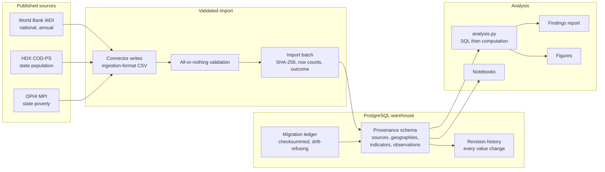
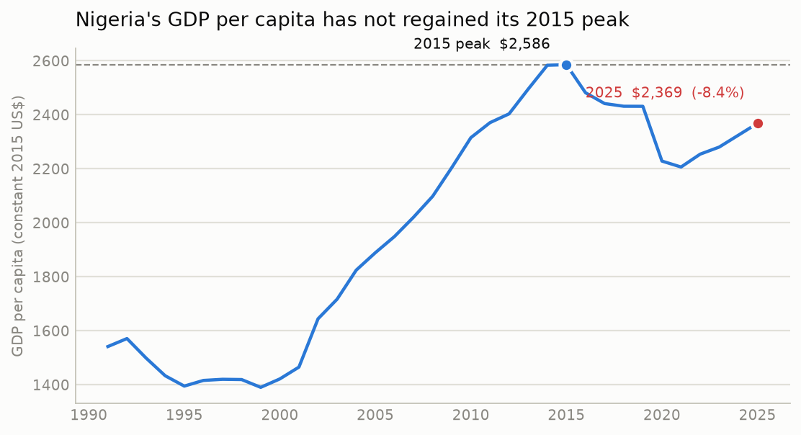
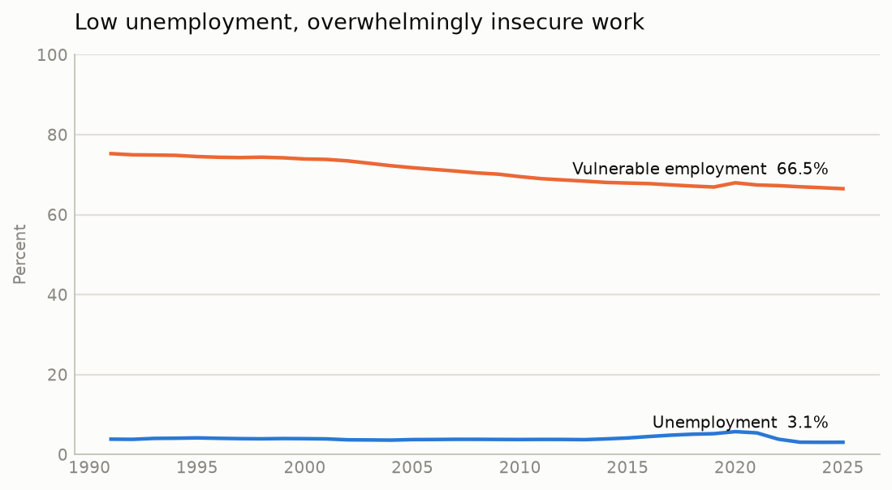
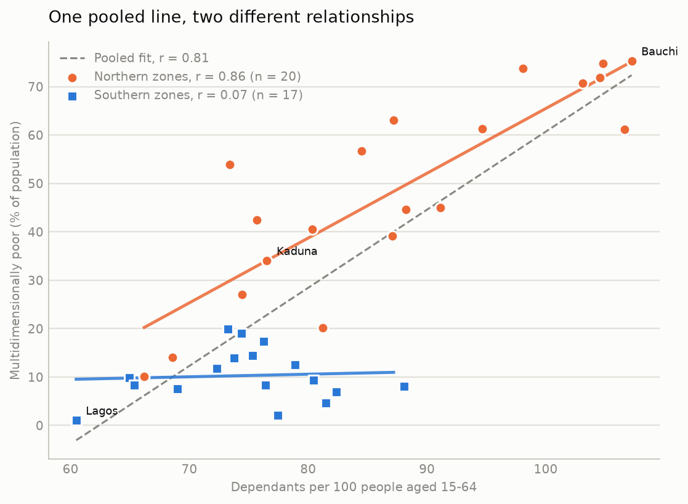
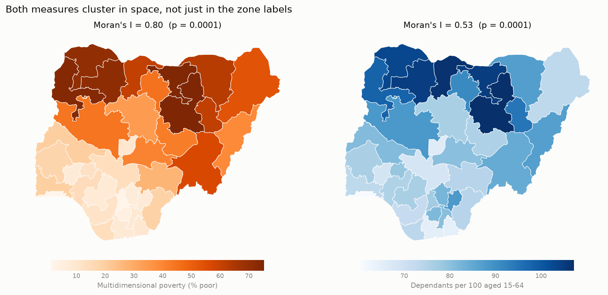

# Nigeria Economic and Labour Market Intelligence

[](https://github.com/asgatcreation/nigeria-economic-intelligence/actions/workflows/ci.yml)

A reproducible data science project for exploring, analysing, and modelling
Nigeria's economic and labour-market indicators.

## Technology stack

- Python for data engineering, statistical analysis, and machine learning
- R for statistical modelling and survey analysis
- PostgreSQL for structured data storage
- SQL for data querying and analytical transformations
- Docker for isolated database infrastructure

## How it fits together



Nothing reaches the warehouse except through the validated, batch-tracked
import path, and nothing reaches the report except through `analysis.py`.
That is what makes every number in the report traceable to a file and a
source.

## Findings

**[Read the analysis: Nigeria — growth, prices, work and population,
1991–2025](reports/nigeria_economic_findings.md)**

935 observations across 26 indicators, national and for all 36 states
plus the FCT. The headline results:

- GDP per capita **peaked in 2015** and is still 8.4% below it a decade
  later.
- Measured unemployment of 3.1% sits alongside **66.5% vulnerable
  employment**. One reading is that job quality rather than joblessness
  is the binding constraint, and that the unemployment rate carries
  little information in this labour market.
- Labour left agriculture for services while manufacturing's share of
  output fell from 19.5% to 8.3% of GDP: structural change without
  industrialisation.
- **Age dependency splits the country**: each 100 working-age people
  support 60 dependants in Lagos but 107 in Bauchi, so the national
  averages describe no actual state well.
- **State poverty ranges 68-fold**, 1.1% of people in Lagos to 75.4%
  in Bauchi. It tracks age dependency at r = 0.81 — but that splits
  into a strong northern relationship (r = 0.86) and a flat southern
  one, and the report gives both rather than the pooled figure alone.
- **The two regimes are a tested difference, not an impression.** An
  interaction model with HC3 robust errors puts the gap between the
  slopes at 1.29 points of poverty per dependant (p = 0.0001), and it
  survives dropping the three states with Cook's distance above 4/n.
  With 17 southern states, though, the southern interval runs from
  −0.46 to 0.50: that is absence of evidence, not evidence of absence.
- **The regional pattern is genuinely spatial.** Moran's I on
  four-nearest-neighbour weights is 0.80 for poverty and 0.53 for
  dependency, both at the floor of 9,999 permutations — found without
  the test ever seeing the north/south labels used to define the
  groups.

Every number in the report is computed from the warehouse by
[`analysis.py`](src/nigeria_economic_intelligence/analysis.py) and
reproducible with one command. Nothing is hand-entered.

### Three charts that carry the argument

A decade with no gain in GDP per capita — the 2015 peak has not been
regained in the ten years since:



The labour-market paradox: a 3.1% unemployment rate alongside 66.5%
vulnerable employment — two indicators of the same labour market that
describe entirely different places:



State poverty against age dependency. The pooled correlation is r = 0.81,
but the northern and southern states form two separate regimes, so the
report gives the pooled figure and the subsets together:





All thirteen figures are in [`reports/figures/`](reports/figures) and
are regenerated by `analysis.py --figures`.

### Statistical methods

Everything below is implemented in the repository and tested against
cases with known answers, rather than taken from a library and quoted:

| Method | Where | Why it is there |
|---|---|---|
| Fisher z and percentile bootstrap intervals | `analysis.correlation_interval` | Two routes to the same interval; agreement means it is not an artefact of the normality assumption |
| OLS with an interaction term, HC3 errors | `analysis.poverty_model` | Tests the difference between two slopes instead of asserting it from two separate correlations |
| Leverage, Cook's distance, refit without influential points | `analysis.poverty_model` | Shows whether a conclusion rests on three states |
| Moran's I with permutation inference | `spatial.py` | Tests whether the regional pattern is spatial without being told where north is |
| k-nearest-neighbour spatial weights, reported across k | `spatial.knn_weights` | k is a choice, so it is shown rather than fixed at a flattering value |

## Project status

The pipeline is complete and loaded with real data. Validated imports are
recorded as tracked batches, every value change is captured in a revision
history, and schema changes are applied through a migration ledger.

State-level data covers all 36 states and the FCT, arranged under the six
geopolitical zones: population structure, multidimensional poverty and
land area, with administrative boundaries held as a reference artefact
for mapping and spatial statistics.

Continuous integration runs the migrations against a clean PostgreSQL 17
service container, then the test suite, then the R connectivity check. It
is honest about one limit: the published observations are fetched from the
World Bank and HDX rather than committed to the repository, so the CI
database has the schema but no data. The eleven tests that assert on
loaded values are marked `warehouse` and deselected there; the other 125
run on every push, covering the migrations, the schema and its CHECK
constraints, the validator, the revision trigger, batch tracking, all
four connectors against recorded fixtures, and the whole of the
statistical and spatial code against constructed data whose answers are
known. 141 tests pass in total; the full suite runs locally after
ingesting.

That split earned its keep on the first CI run, which failed: two trigger
tests picked whichever observation happened to be first in the table, so
they passed on a loaded warehouse and failed on a clean one. They now
build their own row inside the rolled-back transaction they were already
using, and a third test checks the rollback leaves nothing behind.

Known gaps, in the order they bind:

| Gap | Why it is open |
|---|---|
| State output data (GDP, IGR, unemployment) | Published by the NBS only as PDF reports, so a document-parsing problem rather than an API call |
| Monthly inflation and exchange rates | The warehouse supports a `frequency` column but holds annual series only, so within-year dynamics cannot be resolved |
| Cross-checking against NBS and CBN | National series are World Bank WDI alone |

## Getting started

### 1. Start the database

The database runs in Docker and is published on `127.0.0.1:5434` so it does
not collide with other local PostgreSQL instances.

```bash
docker compose up -d
```

Credentials are read from `.env` (not committed). It must define:

```
POSTGRES_USER=...
POSTGRES_PASSWORD=...
POSTGRES_DB=...
```

### 2. Install the Python package

```bash
python -m venv .venv
.venv/Scripts/python -m pip install -e ".[analysis,dev]"
```

Installing in editable mode is what puts `nigeria_economic_intelligence` on
the import path; the test suite will not collect without it.

### 3. Apply the schema

```bash
python -m nigeria_economic_intelligence.migrate up
```

### 4. Run the tests

```bash
python -m pytest                      # everything
python -m pytest -m "not warehouse"   # what CI runs: no loaded data needed
```

To reproduce CI's conditions exactly — the schema with no data in it —
point the same command at an empty database:

```bash
createdb nei_ci_sim
POSTGRES_DB=nei_ci_sim python -m nigeria_economic_intelligence.migrate up
POSTGRES_DB=nei_ci_sim python -m pytest -m "not warehouse"
```

Most tests talk to the running database, so step 1 and step 3 must be done
first. The `warehouse` marker separates the tests that need the published
data to have been ingested from those that need only the schema.

## Working with migrations

Migrations are plain `.sql` files in `sql/`, applied in filename order and
recorded in the `schema_migrations` table along with a checksum of each file.

```bash
python -m nigeria_economic_intelligence.migrate status    # what has run
python -m nigeria_economic_intelligence.migrate up        # apply pending
python -m nigeria_economic_intelligence.migrate baseline  # record without running
```

Each migration runs in its own transaction and is rolled back if it fails.
Editing a migration that has already been applied is refused — the checksum
no longer matches — so schema changes go into a new numbered file instead.
`baseline` exists for adopting a database whose schema was created outside
the runner.

## Importing data

```bash
# Check a file without touching the database
python -m nigeria_economic_intelligence.ingestion path/to/file.csv --validate-only

# Validate and import
python -m nigeria_economic_intelligence.ingestion path/to/file.csv
```

### Required CSV columns

`source_code`, `source_name`, `geo_code`, `geo_name`, `geo_level`,
`indicator_code`, `indicator_name`, `domain`, `period_start`, `period_end`,
`value`.

### Optional columns

`organization`, `source_url`, `methodology`, `accessed_on`, `source_notes`,
`indicator_unit`, `indicator_description`, `frequency`, `unit`,
`observation_status`, `notes`.

See `data/reference/demo_synthetic_indicators.csv` for a working example.

### Loading real data

The World Bank connector fetches Nigeria indicators and writes them in the
format above, so the import goes through the same validation, transactions
and batch tracking as any other file:

```bash
# National indicators from the World Bank
python -m nigeria_economic_intelligence.sources.worldbank --ingest

# State population structure for all 37 states, from HDX
python -m nigeria_economic_intelligence.sources.hdx_population --ingest

# State multidimensional poverty, from OPHI via HDX
python -m nigeria_economic_intelligence.sources.ophi_mpi --ingest

# State boundaries and land areas, from OCHA COD-AB via HDX
python -m nigeria_economic_intelligence.sources.cod_ab_boundaries --ingest

# Or fetch only, to inspect the CSV first
python -m nigeria_economic_intelligence.sources.worldbank
```

### Sources and licences

| Source | Publisher | Covers | Licence |
|---|---|---|---|
| World Development Indicators | World Bank | 14 national annual series, 1991–2025 | CC BY 4.0 |
| COD-PS Nigeria 2022 | UNFPA / US Census Bureau, via HDX | State population by age band | See the HDX dataset page |
| Global MPI 2021 | OPHI, via HDX | State multidimensional poverty, from MICS 2021 | See the HDX dataset page |
| COD-AB Nigeria | OCHA FISS, via HDX | State boundaries and land areas | CC BY-IGO 3.0 |

Boundary geometry is the one thing deliberately *not* loaded into the
warehouse. The schema stores an indicator observation — a number for an
indicator, a place and a period — and a polygon is none of those, so
rather than bend the schema the boundaries stay a checksummed reference
artefact that the mapping and spatial-weights code reads directly. The
land areas published alongside them *are* observations, and go through
the ordinary validated, batch-tracked import path.

Seven of the fourteen series are ILO *modelled* estimates rather than
Nigerian survey results. Those are stored with
`observation_status = 'estimated'` and a note recording that they are not
comparable with NBS published figures, so the distinction lives in the data
rather than only in documentation.

## Exploratory notebook

[`notebooks/01_exploratory_analysis.ipynb`](notebooks/01_exploratory_analysis.ipynb)
goes beyond the written report: it queries the warehouse's provenance
structure directly, tests the national series for stationarity,
re-examines the inflation / GDP per capita relationship on a basis the
data actually supports, and works the state poverty correlation out from
scratch — pooled, then within each group, then by rank — to show why the
pooled figure should not be quoted on its own. It is committed with its
outputs, so it reads on GitHub without being run.

```bash
jupyter lab notebooks/01_exploratory_analysis.ipynb
```

## Running the analysis

```bash
python -m nigeria_economic_intelligence.analysis            # print findings
python -m nigeria_economic_intelligence.analysis --figures  # and write charts
```

Findings are read from the warehouse by SQL and computed in code, so the
report regenerates after any re-import. Figures are written to
`reports/figures/`.

### How an import behaves

Validation is all-or-nothing: a single bad row rejects the whole file, and
nothing is written to the warehouse. Observations are then upserted in one
transaction, so a partially applied import is not possible.

Every import — successful or rejected — is recorded in
`data_import_batches` with the filename, a SHA-256 digest of the file, row
counts, and the error message if it failed. Imported observations carry
`last_import_batch_id`, so any value in the warehouse can be traced back to
the file it came from.

Re-importing a file whose values have changed updates the observations in
place and the revision trigger records the before-and-after values in
`indicator_observation_revisions`, attributed to the import batch that made
the change. Manual updates outside an import are still recorded, with a null
`batch_id`.

## Database schema

| Table | Purpose |
| --- | --- |
| `data_sources` | Provenance: who published the data, how, and when it was accessed |
| `geographies` | Nigerian geographic units, self-referencing for hierarchy |
| `indicators` | Indicator definitions, domain, unit, and frequency |
| `indicator_observations` | The measured values, unique per indicator/geography/source/period |
| `indicator_observation_revisions` | Audit trail of every value, unit, status, or note change |
| `data_import_batches` | One row per ingestion attempt, with row counts and outcome |
| `schema_migrations` | Which migration files have been applied, with checksums |

Geography is hierarchical: the 37 states hang off six geopolitical zones,
which hang off the country, so state observations roll up to zone and
national level by walking `parent_id`.

## Repository layout

```
data/reference/   synthetic data committed to the repository
data/raw/         source files, not committed
data/processed/   derived datasets, not committed
docs/             written analysis and documentation
notebooks/        exploratory Jupyter notebooks (committed with outputs)
r/                R scripts for statistical modelling
reports/          the written analysis and its figures
sql/              numbered migrations
src/              the nigeria_economic_intelligence package
src/.../sources/  connectors that fetch from external publishers
tests/            pytest suite and an R connectivity check
```

## R connectivity

```bash
Rscript tests/test_r_postgres.R
```

Requires the `DBI` and `RPostgres` packages.

## Data integrity

No real economic figures are invented or assumed anywhere in this project.
The only values in the repository are in
`data/reference/demo_synthetic_indicators.csv`, which is labelled synthetic
and exists solely to exercise the pipeline. Real indicator data must be
imported from a cited source with its provenance recorded in `data_sources`.
