# Nigeria: growth, prices, work and population, 1991–2025

An analysis of 935 observations across 26 indicators, read from the
project's PostgreSQL warehouse. Every figure quoted below is computed by
[`analysis.py`](../src/nigeria_economic_intelligence/analysis.py) from
SQL against that warehouse, not transcribed by hand, and can be
reproduced with one command.

---

## Summary

Six findings, in descending order of how much they change the picture:

1. **GDP per capita peaked in 2015 and has not recovered.** At $2,369
   (constant 2015 US$) in 2025, GDP per capita is **8.4% below** its
   2015 peak of $2,586 — a decade without progress in average living
   standards.
2. **Unemployment is the wrong indicator for Nigeria.** A measured
   unemployment rate of 3.1% sits alongside **66.5% vulnerable
   employment**. One reading is that the binding constraint here is job
   *quality* rather than job scarcity.
3. **Labour left agriculture for services, not industry.** Agriculture's
   employment share fell 20.3 points since 1991 while manufacturing's
   share of output fell from 19.5% to 8.3% of GDP — structural change
   without industrialisation.
4. **Age dependency splits the country.** Each 100 working-age
   people support 60 dependants in Lagos but 107 in Bauchi. The
   North West holds both the largest workforce and the heaviest
   dependency burden, so national averages describe no actual state
   well.
5. **State poverty ranges 68-fold**, from 1.1% of people in Lagos to
   75.4% in Bauchi. It correlates with age dependency at r = 0.81,
   but that pooled figure hides two regimes. A model with an
   interaction term puts the difference in slope at **1.29 points of
   poverty per dependant (p = 0.0001)**: the relationship is strong
   in the north (r = 0.86) and flat in the south — though with only
   17 southern states, the southern interval runs from −0.46 to 0.50
   and establishes no absence. Both measures are spatially clustered
   on a test that never sees the zone labels (Moran's I = 0.80 and
   0.53).
6. **Oil's measured share of output has collapsed** from 28.7% of GDP
   (1993) to 6.2% (2021), and correlates only weakly with growth
   (r = 0.12). This is a genuine finding about the *rents* measure, and
   emphatically **not** evidence that oil no longer matters — see the
   caveat below.

---

## Data and method

| | |
|---|---|
| **National source** | World Bank, World Development Indicators (API v2) |
| **State sources** | COD-PS Nigeria 2022 (UNFPA / US Census Bureau); OPHI global MPI from MICS 2021; COD-AB admin boundaries and land areas (OCHA, CC BY-IGO 3.0) — all via HDX |
| **Geography** | Nigeria national; 36 states and the FCT, grouped into 6 zones |
| **Period** | 1991–2025 national (oil rents to 2021); 2022 state population; 2021 state poverty |
| **Observations** | 935 across 26 indicators (excludes the 2 synthetic demo rows) |
| **Retrieved** | 2 November 2026 |

Data is fetched by a connector that writes a CSV in the project's
ingestion format, which then passes through the same validation,
transaction handling and batch tracking as any other import. The fetched
file is retained, so the import is reproducible from the raw artefact,
and every observation in the warehouse carries the import batch it came
from.

### One caveat that shapes every labour-market reading

Seven of the fourteen series are **ILO modelled estimates**, not
Nigeria's own survey results. They are stored in the warehouse with
`observation_status = 'estimated'` rather than `'observed'`, so the
distinction survives in the data itself and is not merely a footnote
here.

This matters concretely. Nigeria's National Bureau of Statistics revised
its labour-force methodology in 2023; its published unemployment rate is
**not comparable** with the modelled series used here, and the two
should never be quoted side by side. The modelled series are internally
consistent over time, which is what makes them usable for the trend
analysis below — but their *levels* should not be read as Nigeria's
official figures.

---

## 1. A decade without growth in GDP per capita

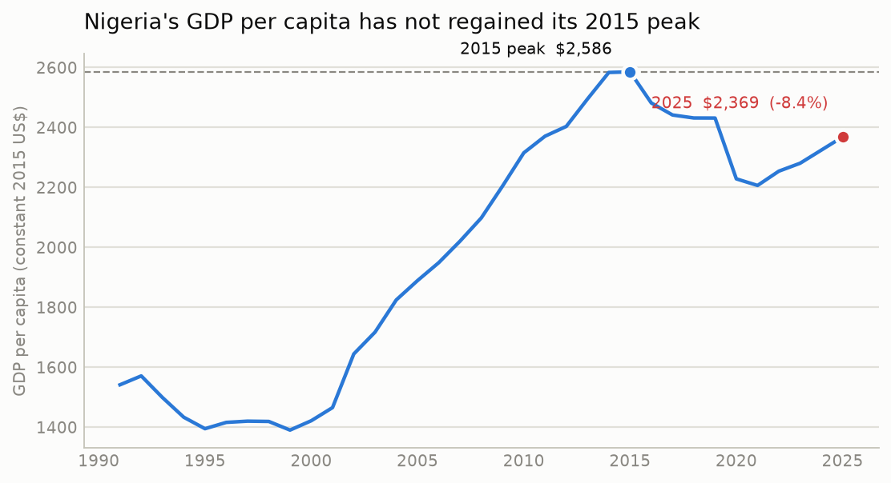

Nigeria's GDP per capita rose strongly through the 2000s — from
$1,542 in 1991 to a peak of $2,586 in 2015 — then fell and has stayed
below that peak for **ten consecutive years**.

The mechanism is visible when output growth is set against population
growth:

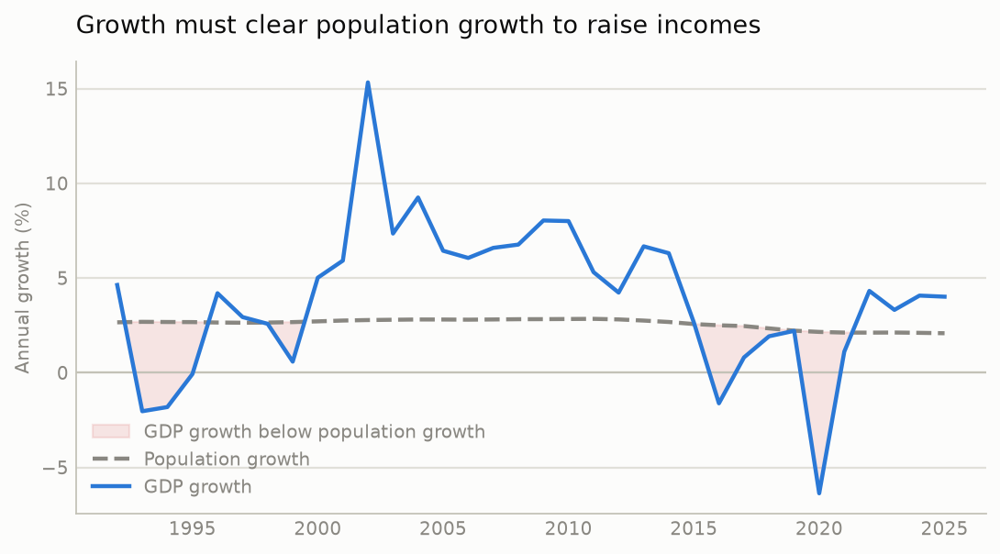

GDP per capita rises only when output grows faster than population.
In **6 of the 11 years** since the 2015 peak, it did not. Nigeria's
population has been growing at roughly 2.1–2.6% a year throughout, which
sets a demanding floor: growth below that figure means average incomes
*fall*, regardless of a positive headline number.

This reframes the recent recovery. Growth of 4.0% in 2025 sounds healthy
and, against population growth of 2.1%, it does raise incomes — but from
a level still well short of 2015. Closing an 8.4% gap at ~1.9 points of
per-capita growth a year takes roughly four to five more years of
uninterrupted performance at that rate.

## 2. Inflation

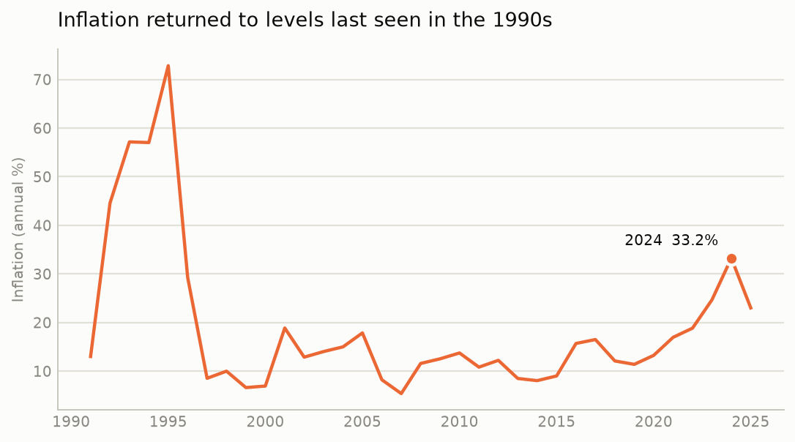

Annual consumer price inflation, measured as the year-on-year change in
the CPI (% per year), reached **33.2% in 2024**, the highest since the
1990s, before easing to 23.0% in 2025. For context, the series peak is
72.8% in 1995,
so this is not unprecedented — but it follows two decades in which
inflation mostly sat in the 10–18% range.

Inflation at this level interacts directly with finding 1: it erodes
real wages faster than nominal pay adjusts, so the lived experience of
the income shortfall is sharper than the per-capita series alone implies.

## 3. The unemployment paradox

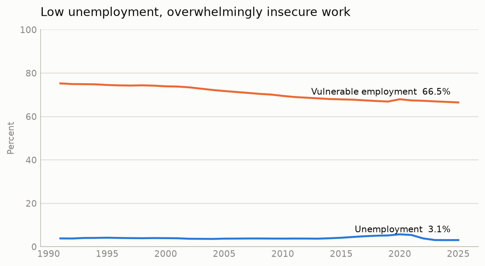

This is the most important chart in the analysis, and the one most often
read wrongly.

| Indicator (2025, modelled) | Value |
|---|---|
| Unemployment rate | 3.1% |
| Youth unemployment (15–24) | 5.3% |
| Labour force participation (15+) | 82.5% |
| **Vulnerable employment** | **66.5%** |

A 3.1% unemployment rate would, in a high-income economy, describe an
economy at or beyond full employment. Here it describes something quite
different.

What the data shows is three numbers that sit oddly together: very high
participation (82.5%), very low unemployment (3.1%), and two in three
workers (66.5%) in own-account or unpaid family work, outside formal
contracts and social protection.

**One reading is** that the absence of unemployment insurance explains
the combination. Without income support, being unemployed is not an
affordable state: people take whatever work is available rather than
search while jobless, and are therefore recorded as *employed* — in
own-account work, unpaid family labour and informal activity — rather
than as unemployed. On that reading, the indicator carrying information
is vulnerable employment, not the unemployment rate. The data here is
consistent with it, but does not establish it: testing it needs
job-search and informality data this analysis does not have.

To be accurate about the direction of travel: this figure has *improved*
since 1991, falling 8.8 points from 75.3%. But that is 0.26 points a
year — a pace at which halving the current figure would take roughly
130 years. The trend is real; its speed is not.

**One reading, stated as such:** policy and analysis aimed at "reducing
unemployment" in Nigeria is aimed at a number that is already low and
largely uninformative, and the measurable problem is the quality,
security and productivity of work people already have. That is an
interpretation of the figures above, not a result computed from them.

## 4. Structural change without industrialisation

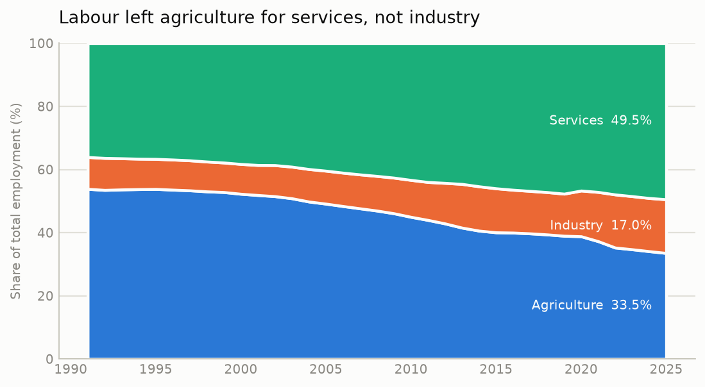

Labour has moved decisively out of agriculture since 1991:

| Sector | Employment share shift, 1991–2025 |
|---|---|
| Agriculture | **−20.3 points** (53.8% → 33.5%) |
| Services | **+13.4 points** (36.1% → 49.5%) |
| Industry | +6.9 points (10.1% → 17.0%) |

Labour leaving agriculture is ordinary, expected development. What makes
this unusual is what happened to output at the same time:

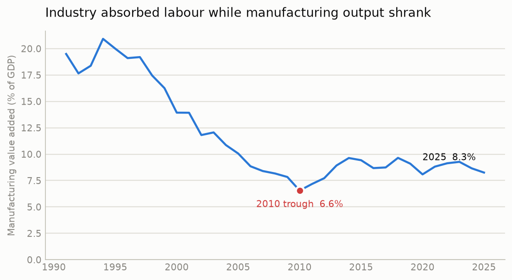

Manufacturing's share of GDP fell from **19.5% in 1991 to 8.3% in
2025**, bottoming at 6.6% in 2010. Industry absorbed some labour while
manufacturing output shrank as a share of the economy — the pattern
usually called **premature deindustrialisation**: workers exit
low-productivity agriculture but are absorbed by services rather than by
a growing industrial base.

What the data shows alongside this is that agriculture still produces
23.0% of GDP while employing 33.5% of workers — a productivity gap —
and that the employment gain went to services, not to manufacturing.

**One reading** is that services in this context are substantially the
same informal, own-account activity counted in finding 3, which would
make the sectoral shift and the job-quality problem one finding rather
than two. Separating formal from informal services would test that; this
dataset does not split the services aggregate.

## 5. Oil: what the rents measure does and does not show

Oil rents fell from a peak of **28.7% of GDP in 1993 to 6.2% in 2021**,
and their correlation with annual GDP growth over 1991–2021 is weak
(Pearson r = 0.12, n = 31).

**This must not be read as "oil no longer matters to Nigeria."** Oil
rents as a share of GDP measures one specific thing: resource rent
relative to total output. It is a poor proxy for oil's actual macro
importance, because:

- The share falls mechanically when the *non-oil* economy grows, even
  with oil output flat.
- It says nothing about oil's share of **government revenue** or of
  **foreign exchange earnings**, which is where Nigeria's oil dependence
  actually binds — and neither is in this dataset.
- A contemporaneous annual correlation would miss lagged and
  fiscally-mediated transmission in any case.

The honest conclusion is narrow: *the rents-to-GDP ratio has fallen and
does not track annual growth.* Testing oil dependence properly requires
fiscal and external-sector data this analysis does not have. That is a
stated gap, not a finding.

## 6. The north–south demographic divide

Everything above is national, and national figures conceal a split that
matters for every labour-market conclusion in this report.

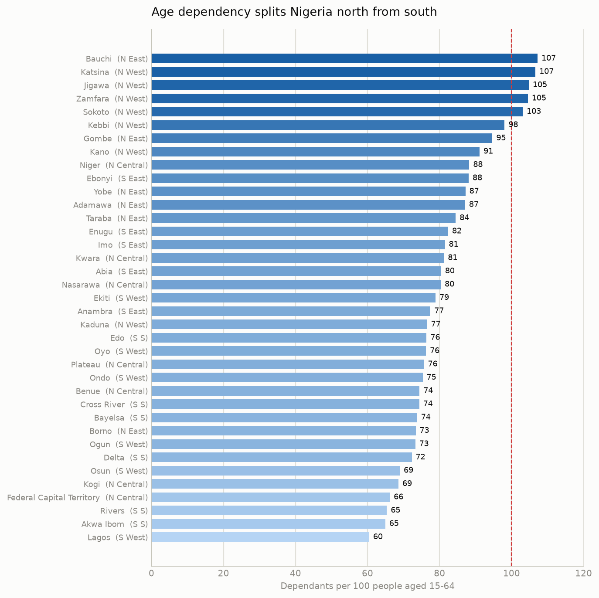

The **age dependency ratio** — how many children and elderly each 100
working-age people support — ranges from **60.5 in Lagos to 107.2 in
Bauchi**. Five states (Bauchi, Jigawa, Katsina, Sokoto, Zamfara) are
above 100: in those states the working-age population is *outnumbered*
by the people it supports.

By geopolitical zone:

| Zone | Population | Working age (15–64) | Dependency ratio |
|---|---:|---:|---:|
| North West | 60.2m | 30.7m | **97.8** |
| North East | 30.5m | 16.1m | 89.0 |
| South East | 23.5m | 13.0m | 82.0 |
| North Central | 31.6m | 17.9m | 76.4 |
| South West | 41.2m | 24.3m | 72.2 |
| South South | 29.8m | 17.5m | **71.2** |

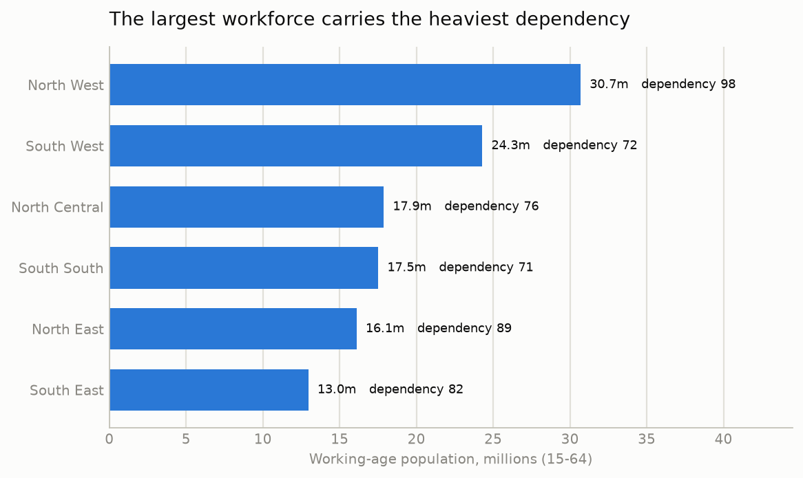

The North West holds Nigeria's **largest workforce (30.7m)** and its
**heaviest dependency burden (97.8)** simultaneously. A worker there
supports roughly one dependant; a worker in the South South supports
about 0.71.

**Why this matters for the earlier findings — one reading.** The
vulnerable-employment and GDP per capita results are national averages
applied to a country whose regions face materially different arithmetic:
the same national output per head stretches further in Lagos than in
Bauchi, because it is divided across fewer dependants. On that reading,
a policy inference drawn from the national figures alone — on job
creation, schooling or social protection — is drawn from an average that
describes no actual state very well. What the data shows is the spread
itself: 60.5 to 107.2 dependants per 100 working-age people.

## 7. State poverty, and a correlation that needs splitting

The state layer is no longer demographic only. OPHI's multidimensional
poverty results for Nigeria, computed from MICS 2021, are published
machine-readable at state level and keyed on the same P-codes as the
geography above.

The MPI counts overlapping deprivations in health, education and living
standards. A person is *multidimensionally poor* when deprived in at
least a third of the weighted indicators.

| | Headcount (% poor) |
|---|---:|
| Lagos | **1.1** |
| Anambra | 2.0 |
| Nigeria (national) | 33.0 |
| Jigawa | 74.8 |
| Bauchi | **75.4** |

A **68-fold** gap between the least and most deprived state. By zone the
mean headcount runs from 6.2% in the South East to 61.6% in the North
West — a tenfold difference inside one country.

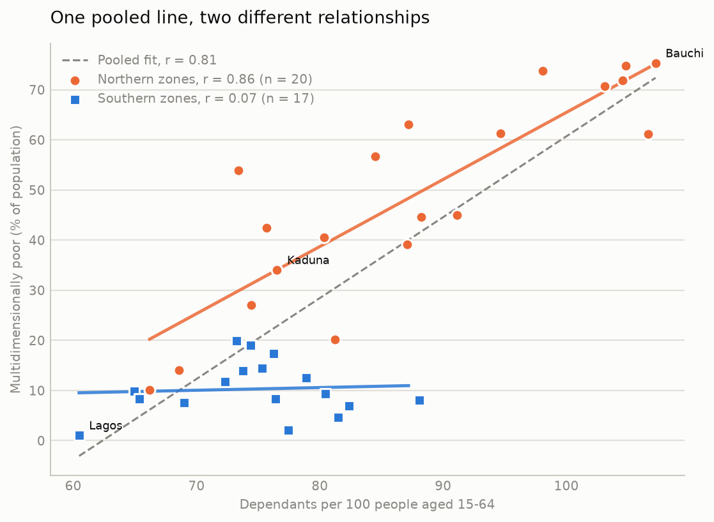

Poverty and age structure track each other closely across the 37
states: Pearson r = **0.81** (p < 1e-9).

**But that pooled figure should not be quoted on its own.** Splitting
the states into northern and southern groups changes the picture
entirely:

| Group | States | r | p | Mean headcount |
|---|---:|---:|---:|---:|
| Northern zones | 20 | **+0.86** | <0.001 | 49.0% |
| Southern zones | 17 | +0.07 | 0.80 | 10.3% |

Inside the north the relationship is strong. Inside the south nothing
of the kind shows up — southern poverty is low whatever the dependency
ratio. (Section 8 qualifies this: with 17 states, the southern estimate
is too imprecise to establish an absence, though the *difference*
between the two slopes is established.) Much of the pooled r = 0.81 is therefore the gap
*between* two groups rather than a single relationship running through
all 37 states, and the scatter shows exactly that: a flat southern
cluster and a steep northern one.

How separated the two groups are is worth stating as a count rather
than leaving to the eye: **18 of the 20 northern states have a higher
poverty headcount than every southern state.** Only the FCT (10.2%) and
Kogi (14.0%) fall inside the southern range at all, against a southern
maximum of 19.9% in Ogun. The medians are 49.5% in the north and 9.4%
in the south. Two groups this far apart are what produce a strong
pooled correlation out of one real relationship and one absent.

Spearman's rank correlation confirms it is not a linearity artefact.
Pooled, rho = 0.65; inside the north, rho = 0.85; inside the south,
rho = −0.16 — pointing the other way, and not distinguishable from
noise at n = 17. So the flat southern result is not Pearson's r missing
a monotone relationship; it is a subset too small to say much either
way, which is what section 8 quantifies.

**What this does and does not say.** Even the northern relationship is
not evidence that age structure causes poverty. High fertility raises
the child population, which mechanically raises the dependency ratio
and is independently associated with poverty, so a common driver
explains much of the association. **One reading** is that dependency and
deprivation describe the *same* regional divide, and that the divide is
sharp enough to make national averages misleading for either. What the
data shows is the two correlations and their difference; the common-driver
account is an interpretation that this dataset cannot test.

## 8. How much of section 7 survives contact with uncertainty

Section 7 reports three correlations as point estimates on 37, 20 and 17
observations. Point estimates at those sample sizes are not findings on
their own, and the comparison of two of them is not a test. This section
attaches intervals, replaces the comparison with a model that tests it,
and then asks whether the north–south pattern is spatial at all or only
an artefact of the zone labels used to define it.

### 8.1 Intervals, not point estimates

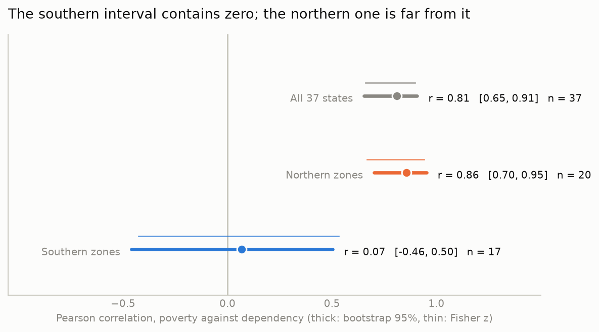

Two intervals are computed for each correlation by different routes.
Fisher's z transform gives the textbook interval and assumes the pair is
bivariate normal. The percentile bootstrap, over 10,000 resamples of the
state pairs, assumes nothing of the kind. Where they agree, the interval
is not an artefact of the assumption.

| Group | n | r | Bootstrap 95% | Fisher z 95% |
|---|---:|---:|---|---|
| All states | 37 | 0.810 | [0.654, 0.908] | [0.660, 0.899] |
| Northern zones | 20 | 0.857 | [0.702, 0.952] | [0.668, 0.942] |
| Southern zones | 17 | 0.068 | **[−0.460, 0.504]** | [−0.426, 0.531] |

They agree closely in all three cases. The southern interval is the one
that matters: it is nearly a unit wide and comfortably contains zero.
The honest statement is not "there is no relationship in the south" but
**"17 states cannot tell us whether there is one."** Anything from a
moderate negative association to a moderate positive one is consistent
with this data.

The northern interval is narrow enough to carry weight, and its lower
bound of 0.70 is still a strong relationship.

### 8.2 One model instead of two correlations

Reporting the two correlations side by side asserts that the
relationship differs between north and south without ever testing that
assertion. A single model with an interaction term tests it directly,
because the interaction coefficient *is* the difference between the two
slopes.

```
headcount ~ dependency * north        HC3 robust standard errors, n = 37
```

| Term | Estimate | Robust SE | p | 95% CI |
|---|---:|---:|---:|---|
| Intercept | 6.31 | 19.63 | 0.748 | [−32.2, 44.8] |
| dependency | 0.053 | 0.256 | 0.835 | [−0.449, 0.556] |
| north | −74.67 | 26.91 | 0.006 | [−127.4, −21.9] |
| **dependency × north** | **1.285** | 0.322 | **0.0001** | [0.653, 1.917] |

Read through to the slopes: in the south, poverty rises **0.05 points
per additional dependant**, which is indistinguishable from flat. In the
north it rises **1.34 points**. The difference of 1.285 is the
interaction term, and p = 0.0001 is the test section 7 was missing. The
two regimes are not an impression from a scatter; they are a
statistically distinguishable difference in slope. R² = 0.883.

Standard errors are HC3 because the residuals are heteroscedastic by
construction — compressed near zero in the south, spread wide in the
north. The Breusch–Pagan test is borderline (p = 0.061) rather than
decisive, but the robust errors are the right default here regardless.
They are *smaller* than the classical ones for every term, so this is
not a case of robustness quietly rescuing a weak result.

### 8.3 Which states are driving it

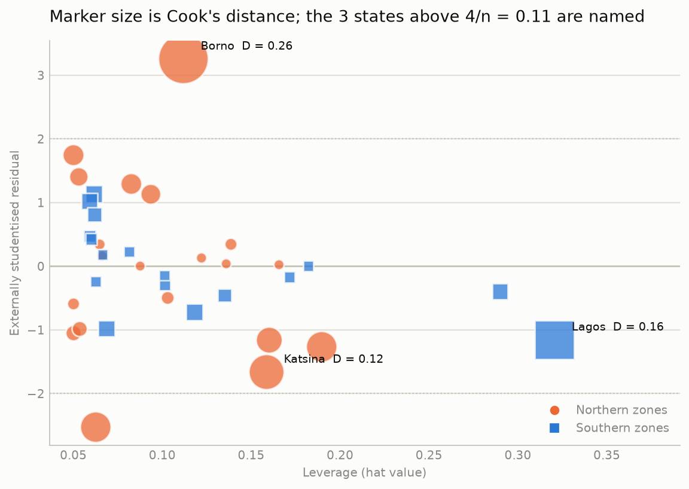

Three states exceed the conventional Cook's distance threshold of
4/n = 0.11. They are not the ones an eye on the scatter would pick:

| State | Cook's D | Why |
|---|---:|---|
| Borno | 0.26 | Large positive residual: much poorer than its dependency ratio predicts |
| Lagos | 0.16 | Highest leverage in the data (0.32) — the extreme low end of both variables |
| Katsina | 0.12 | Negative residual at high leverage |

Borno is the interesting one, and it is not a data error. Borno has been
the centre of a long insurgency with large-scale displacement, so a
poverty rate far above what its age structure predicts is what one would
expect, and its population denominator is a projection carried forward
from 2006 through exactly the period of that displacement.

Refitting without all three (n = 34) does not rescue the southern
relationship or weaken the northern one. The southern slope moves to
**−0.175**, the northern to **+1.554**, and the interaction p-value
falls below 0.0001. The conclusion does not rest on the influential
points.

### 8.4 Is the pattern spatial, or just the zone labels?

Every state finding so far has been expressed through geopolitical
zones — a grouping drawn before the data was looked at. Splitting states
into "north" and "south" and then finding a difference between them is
not entirely free of circularity.

Moran's I needs no such grouping. It asks whether states with similar
values sit closer together than a random re-allocation of the same
values across the same map would put them.

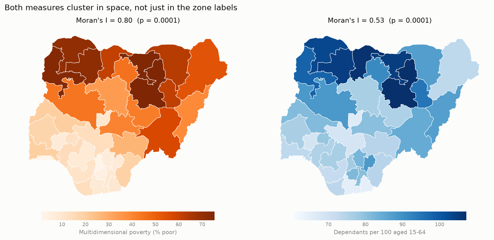

| Measure | Moran's I | E[I] | z | p |
|---|---:|---:|---:|---:|
| Poverty headcount | **+0.799** | −0.028 | +7.98 | 0.0001 |
| Dependency ratio | **+0.530** | −0.028 | +5.47 | 0.0001 |

Both are strongly, positively autocorrelated. The p-values are 0.0001
because that is the floor for 9,999 permutations: no shuffle of the real
values across the real map produced a statistic as extreme as the
observed one. The pattern is spatial, and it is found without being told
where north is.

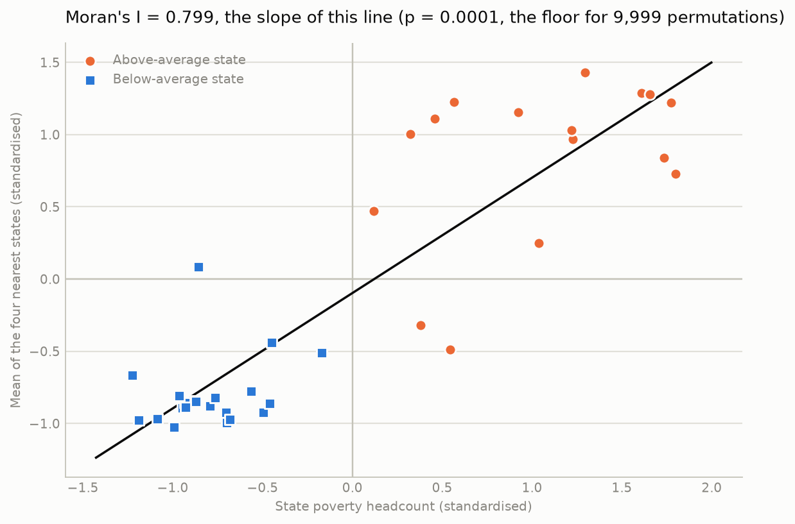

Moran's I is the slope of this line: each state's value against the mean
of its four nearest neighbours. Both quantities are standardised, so the
points in the upper right are poor states surrounded by poor states, and
those in the lower left are the reverse.

Two choices had to be made and are worth stating. Neighbours are the
four nearest states by centroid distance rather than shared borders:
contiguity is the usual choice for administrative units, but deriving it
reliably from generalised boundary polygons is error-prone, while
k-nearest-neighbours is unambiguous and leaves no state isolated.
Because *k* is a free parameter, the statistic is reported across a
range of it:

| k | 3 | 4 | 5 | 6 | 8 |
|---|---:|---:|---:|---:|---:|
| Poverty | 0.82 | 0.80 | 0.81 | 0.76 | 0.68 |
| Dependency | 0.55 | 0.53 | 0.53 | 0.50 | 0.38 |

The decline at k = 8 is expected — averaging over more distant
neighbours dilutes any local pattern — and the conclusion is unchanged
across the range. Inference is permutation-based rather than normal
approximation, which at n = 37 would not be trustworthy.

### 8.5 What section 7 should now be read as saying

- The pooled r = 0.81 is real but is largely the gap between two groups.
- The northern relationship is strong and its interval supports that:
  r = 0.86, [0.70, 0.95].
- The southern "absence" is **not an established absence**. It is 17
  states, an interval from −0.46 to 0.50, and no conclusion either way.
- The *difference* between the two slopes, however, is established:
  p = 0.0001, and it survives dropping the three influential states.
- Both poverty and age structure are spatially clustered on a test that
  never sees the zone labels, so the regional pattern is not an artefact
  of how the groups were drawn.

**One reading**, unchanged from section 7 and still untestable here: the
two measures describe a single regional divide with a common driver
rather than one causing the other. Nothing in this section tests that.
What this section establishes is narrower and firmer — that the
difference in slope is real, that it does not depend on three states,
and that the geography is genuinely clustered.


---

## Limitations

Stated plainly, because they bound every conclusion above:

1. **Modelled labour data.** Seven series are ILO modelled estimates.
   Trends are usable; levels are not official Nigerian figures, and are
   not comparable with post-2023 NBS data.
2. **Recent years may be estimates.** World Bank values for the most
   recent year or two are frequently revised. The 2025 figures should be
   treated as provisional. The warehouse's revision history will capture
   any change on re-import.
3. **State output data is still missing.** State poverty is now
   covered, but state GDP, IGR and unemployment are published by the
   NBS only as PDF reports — its e-library returned HTTP 500 when
   checked, and its MPI release is at senatorial-district rather
   than state level. So the state layer describes deprivation and
   age structure, not output.
4. **State population figures are projections, not a count.** Nigeria's last
   census was in 2006; all current state populations are projected
   forward from it and stored as `'estimated'`. State population
   figures in Nigeria carry political weight — they feed revenue
   allocation and constituency delimitation — which is a reason to
   treat the precision of any single state's figure with care.
5. **Published age bands do not sum exactly to published totals.**
   In the source, the five-year bands differ from the stated total by
   up to 0.17 percentage points. Shares computed here use the
   published total as denominator and so inherit that discrepancy;
   the dependency ratio, being band-over-band, does not.
6. **Poverty and population come from different surveys.** The MPI
   is MICS 2021; the population structure is a 2022 projection.
   Comparing them assumes state age structure did not shift
   materially in a year, which is reasonable but not free.
7. **Annual frequency.** Annual data cannot resolve the within-year
   dynamics that matter for inflation and FX.
8. **Association only.** Section 8 fits a model and tests a difference
   in slopes, which is still not a causal claim: nothing here
   identifies a causal effect, and no such claim is made or supported
   anywhere in this analysis.
9. **Seventeen southern states.** The southern correlation's interval
   spans −0.46 to 0.50. Section 8 reports an absence of evidence, not
   evidence of absence, and the distinction matters for how section 7
   is read.
10. **Spatial weights are a choice.** Moran's I is computed on
    four-nearest-neighbour weights from published state centroids
    rather than shared borders, because contiguity derived from
    generalised polygons is unreliable. The statistic is reported
    across k = 3 to 8 so the choice is visible; the conclusion does
    not turn on it.
11. **Boundary areas are generalised.** COD-AB state areas sum to
    about 1.5% below Nigeria's usually published land area. They are
    internally consistent and comparable between states, and are not
    quoted here as national land area.
12. **Cross-checking.** The national series are World Bank WDI only.
    Cross-checking against NBS and CBN publications would strengthen it
    considerably and is the obvious next step.

## Reproducing this analysis

```bash
docker compose up -d
python -m nigeria_economic_intelligence.migrate up
python -m nigeria_economic_intelligence.sources.worldbank --ingest
python -m nigeria_economic_intelligence.sources.hdx_population --ingest
python -m nigeria_economic_intelligence.sources.ophi_mpi --ingest
python -m nigeria_economic_intelligence.sources.cod_ab_boundaries --ingest
python -m nigeria_economic_intelligence.analysis --figures
```

`analysis.py --figures` prints every number quoted in this report and
regenerates all thirteen figures. Nothing in this document is
hand-entered.

The schema, the import path and the connectors are checked on every push
by GitHub Actions, which applies the migrations to a clean PostgreSQL 17
container and runs the test suite against it. The eleven tests that
assert on *loaded* values cannot run there — the published observations are
fetched rather than committed — so they are marked `warehouse` and run
locally instead. That split is deliberate and is stated in the README
rather than papered over.
