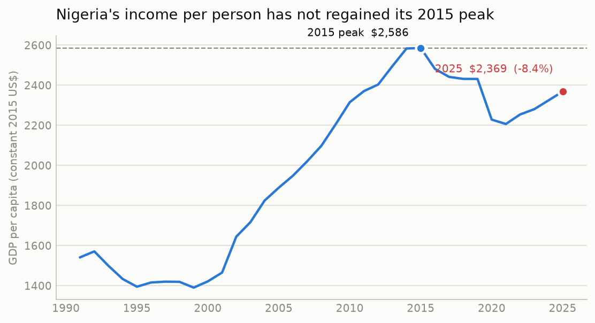
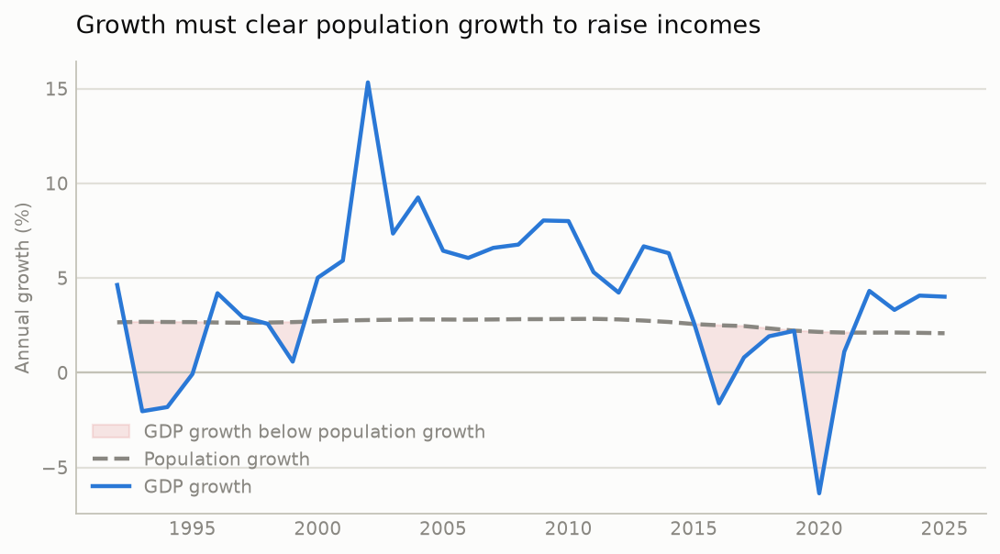
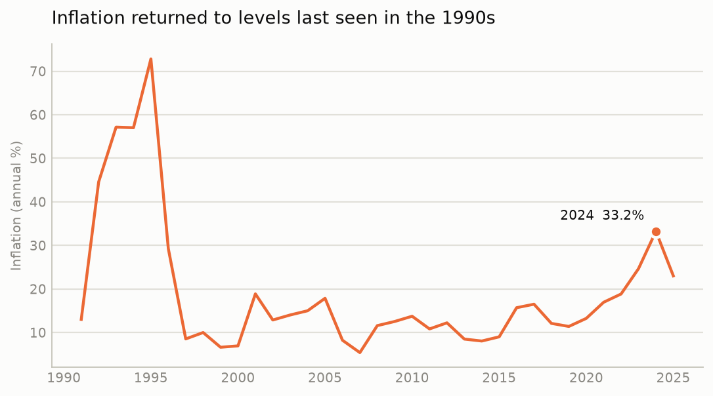
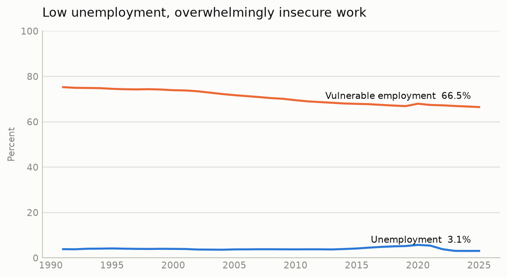
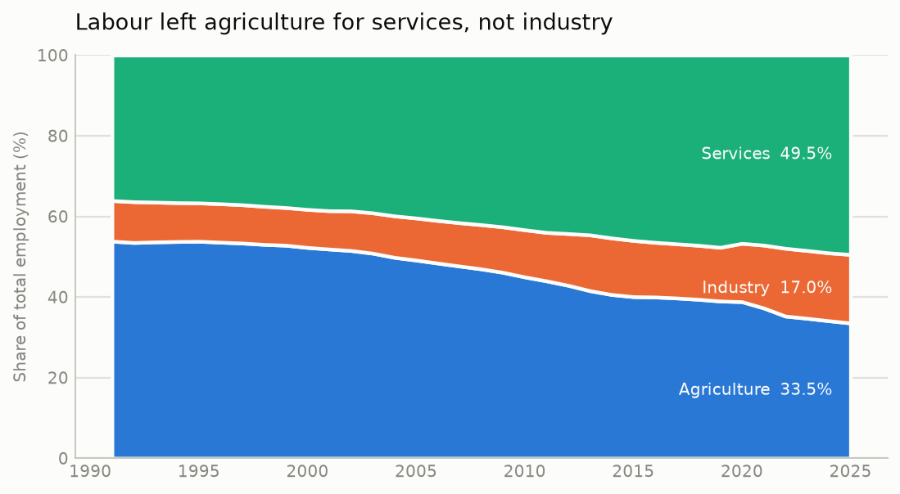
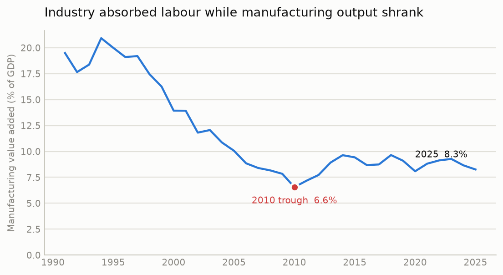
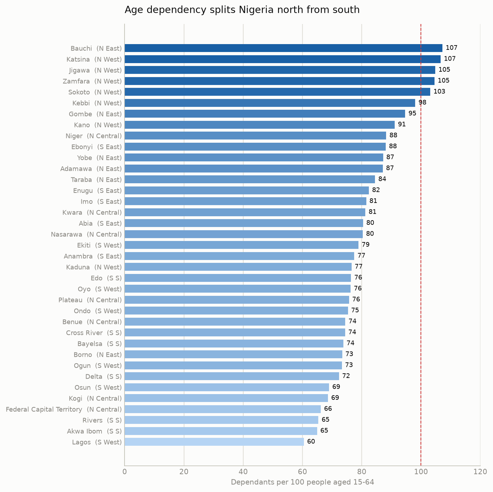
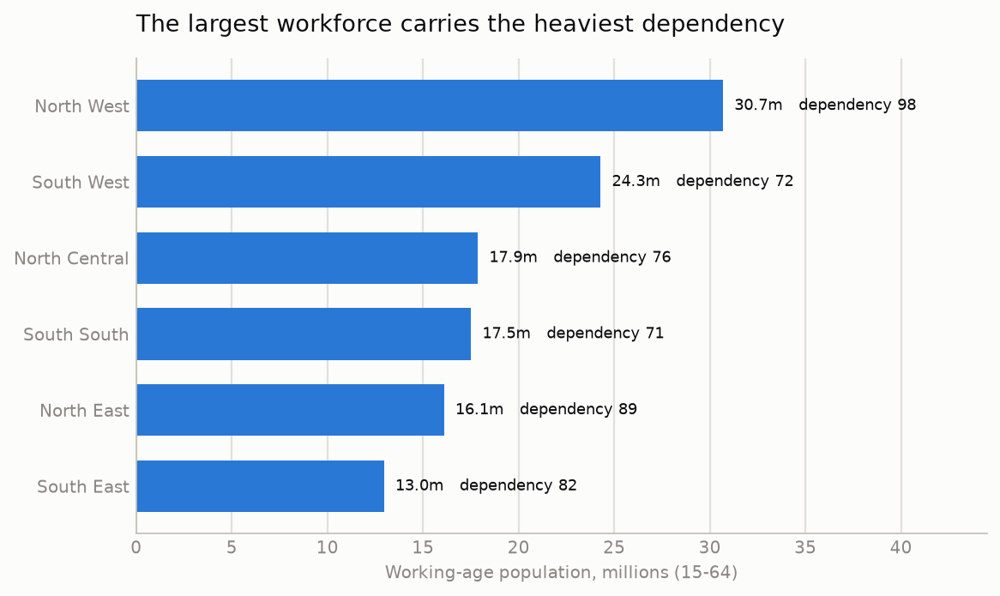
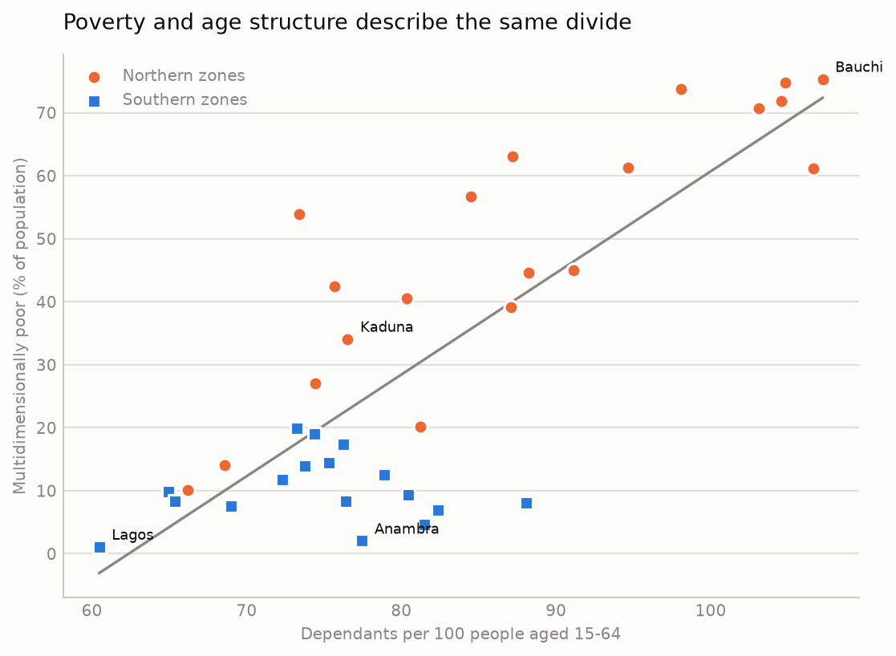

# Nigeria: growth, prices, work and population, 1991–2025

An analysis of 898 observations across 25 indicators, read from the
project's PostgreSQL warehouse. Every figure quoted below is computed by
[`analysis.py`](../src/nigeria_economic_intelligence/analysis.py) from
SQL against that warehouse, not transcribed by hand, and can be
reproduced with one command.

---

## Summary

Six findings, in descending order of how much they change the picture:

1. **Income per person peaked in 2015 and has not recovered.** At $2,369
   (constant 2015 US$) in 2025, GDP per capita is **8.4% below** its
   2015 peak of $2,586 — a decade without progress in average living
   standards.
2. **Unemployment is the wrong indicator for Nigeria.** A measured
   unemployment rate of 3.1% sits alongside **66.5% vulnerable
   employment**. The binding constraint is job *quality*, not job
   scarcity.
3. **Labour left agriculture for services, not industry.** Agriculture's
   employment share fell 20.3 points since 1991 while manufacturing's
   share of output fell from 19.5% to 8.3% of GDP — structural change
   without industrialisation.
4. **Age dependency splits the country.** Each 100 working-age
   people support 60 dependants in Lagos but 107 in Bauchi. The
   North West holds both the largest workforce and the heaviest
   dependency burden, so national averages describe no actual state
   well.
5. **State poverty ranges 68-fold**, from 1.1% of people in Lagos to
   75.4% in Bauchi. It correlates with age dependency at r = 0.81,
   but that pooled figure hides two regimes: strong inside the north
   (r = 0.86), absent inside the south (r = 0.07).
6. **Oil's measured share of output has collapsed** from 28.7% of GDP
   (1993) to 6.2% (2021), and correlates only weakly with growth
   (r = 0.12). This is a genuine finding about the *rents* measure, and
   emphatically **not** evidence that oil no longer matters — see the
   caveat below.

---

## Data and method

| | |
|---|---|
| **National source** | World Bank, World Development Indicators (API v2) |
| **State sources** | COD-PS Nigeria 2022 (UNFPA / US Census Bureau); OPHI global MPI from MICS 2021 — both via HDX |
| **Geography** | Nigeria national; 36 states and the FCT, grouped into 6 zones |
| **Period** | 1991–2025 national (oil rents to 2021); 2022 state population; 2021 state poverty |
| **Observations** | 898 across 25 indicators (excludes the 2 synthetic demo rows) |
| **Retrieved** | 2 November 2026 |

Data is fetched by a connector that writes a CSV in the project's
ingestion format, which then passes through the same validation,
transaction handling and batch tracking as any other import. The fetched
file is retained, so the import is reproducible from the raw artefact,
and every observation in the warehouse carries the import batch it came
from.

### One caveat that shapes every labour-market reading

Seven of the fourteen series are **ILO modelled estimates**, not
Nigeria's own survey results. They are stored in the warehouse with
`observation_status = 'estimated'` rather than `'observed'`, so the
distinction survives in the data itself and is not merely a footnote
here.

This matters concretely. Nigeria's National Bureau of Statistics revised
its labour-force methodology in 2023; its published unemployment rate is
**not comparable** with the modelled series used here, and the two
should never be quoted side by side. The modelled series are internally
consistent over time, which is what makes them usable for the trend
analysis below — but their *levels* should not be read as Nigeria's
official figures.

---

## 1. A decade without income growth



Nigeria's income per person rose strongly through the 2000s — from
$1,542 in 1991 to a peak of $2,586 in 2015 — then fell and has stayed
below that peak for **ten consecutive years**.

The mechanism is visible when output growth is set against population
growth:



Per-capita income rises only when output grows faster than population.
In **6 of the 11 years** since the 2015 peak, it did not. Nigeria's
population has been growing at roughly 2.1–2.6% a year throughout, which
sets a demanding floor: growth below that figure means average incomes
*fall*, regardless of a positive headline number.

This reframes the recent recovery. Growth of 4.0% in 2025 sounds healthy
and, against population growth of 2.1%, it does raise incomes — but from
a level still well short of 2015. Closing an 8.4% gap at ~1.9 points of
per-capita growth a year takes roughly four to five more years of
uninterrupted performance at that rate.

## 2. Inflation



Inflation reached **33.2% in 2024**, the highest since the 1990s, before
easing to 23.0% in 2025. For context, the series peak is 72.8% in 1995,
so this is not unprecedented — but it follows two decades in which
inflation mostly sat in the 10–18% range.

Inflation at this level interacts directly with finding 1: it erodes
real wages faster than nominal pay adjusts, so the lived experience of
the income shortfall is sharper than the per-capita series alone implies.

## 3. The unemployment paradox



This is the most important chart in the analysis, and the one most often
read wrongly.

| Indicator (2025, modelled) | Value |
|---|---|
| Unemployment rate | 3.1% |
| Youth unemployment (15–24) | 5.3% |
| Labour force participation (15+) | 82.5% |
| **Vulnerable employment** | **66.5%** |

A 3.1% unemployment rate would, in a high-income economy, describe an
economy at or beyond full employment. Here it describes something quite
different.

Nigeria has no meaningful unemployment insurance. Without income
support, being unemployed is not an affordable state: people take
whatever work is available rather than search while jobless. They are
therefore recorded as *employed* — in own-account work, unpaid family
labour, and informal activity — rather than as unemployed. Very high
participation (82.5%) alongside very low unemployment (3.1%) is the
signature of exactly this absorption.

The indicator that actually carries information is vulnerable
employment: **two in three Nigerian workers** are in own-account or
unpaid family work, outside formal contracts and social protection.

To be accurate about the direction of travel: this figure has *improved*
since 1991, falling 8.8 points from 75.3%. But that is 0.26 points a
year — a pace at which halving the current figure would take roughly
130 years. The trend is real; its speed is not.

**Implication:** policy and analysis aimed at "reducing unemployment" in
Nigeria is aimed at a number that is already low and largely
uninformative. The measurable problem is the quality, security and
productivity of work that people already have.

## 4. Structural change without industrialisation



Labour has moved decisively out of agriculture since 1991:

| Sector | Employment share shift, 1991–2025 |
|---|---|
| Agriculture | **−20.3 points** (53.8% → 33.5%) |
| Services | **+13.4 points** (36.1% → 49.5%) |
| Industry | +6.9 points (10.1% → 17.0%) |

Labour leaving agriculture is ordinary, expected development. What makes
this unusual is what happened to output at the same time:



Manufacturing's share of GDP fell from **19.5% in 1991 to 8.3% in
2025**, bottoming at 6.6% in 2010. Industry absorbed some labour while
manufacturing output shrank as a share of the economy — the pattern
usually called **premature deindustrialisation**: workers exit
low-productivity agriculture but are absorbed by services rather than by
a growing industrial base.

The significance is that services in this context are substantially the
same informal, own-account activity counted in finding 3. The sectoral
shift and the job-quality problem are not two findings; they are one.
Agriculture still produces 23.0% of GDP while employing 33.5% of
workers, which remains a productivity gap, but the destination of
departing labour has not been higher-productivity manufacturing.

## 5. Oil: what the rents measure does and does not show

Oil rents fell from a peak of **28.7% of GDP in 1993 to 6.2% in 2021**,
and their correlation with annual GDP growth over 1991–2021 is weak
(Pearson r = 0.12, n = 31).

**This must not be read as "oil no longer matters to Nigeria."** Oil
rents as a share of GDP measures one specific thing: resource rent
relative to total output. It is a poor proxy for oil's actual macro
importance, because:

- The share falls mechanically when the *non-oil* economy grows, even
  with oil output flat.
- It says nothing about oil's share of **government revenue** or of
  **foreign exchange earnings**, which is where Nigeria's oil dependence
  actually binds — and neither is in this dataset.
- A contemporaneous annual correlation would miss lagged and
  fiscally-mediated transmission in any case.

The honest conclusion is narrow: *the rents-to-GDP ratio has fallen and
does not track annual growth.* Testing oil dependence properly requires
fiscal and external-sector data this analysis does not have. That is a
stated gap, not a finding.

## 6. The north–south demographic divide

Everything above is national, and national figures conceal a split that
matters for every labour-market conclusion in this report.



The **age dependency ratio** — how many children and elderly each 100
working-age people support — ranges from **60.5 in Lagos to 107.2 in
Bauchi**. Five states (Bauchi, Jigawa, Katsina, Sokoto, Zamfara) are
above 100: in those states the working-age population is *outnumbered*
by the people it supports.

By geopolitical zone:

| Zone | Population | Working age (15–64) | Dependency ratio |
|---|---:|---:|---:|
| North West | 60.2m | 30.7m | **97.8** |
| North East | 30.5m | 16.1m | 89.0 |
| South East | 23.5m | 13.0m | 82.0 |
| North Central | 31.6m | 17.9m | 76.4 |
| South West | 41.2m | 24.3m | 72.2 |
| South South | 29.8m | 17.5m | **71.2** |



The North West holds Nigeria's **largest workforce (30.7m)** and its
**heaviest dependency burden (97.8)** simultaneously. A worker there
supports roughly one dependant; a worker in the South South supports
about 0.71.

**Why this matters for the earlier findings.** The vulnerable-employment
and per-capita-income results are national averages applied to a country
whose regions face materially different arithmetic. The same national
income per head stretches much further in Lagos than in Bauchi, because
it is divided across fewer dependants. Any policy inference drawn from
the national figures alone — on job creation, schooling or social
protection — is being drawn from an average that describes no actual
state very well.

## 7. State poverty, and a correlation that needs splitting

The state layer is no longer demographic only. OPHI's multidimensional
poverty results for Nigeria, computed from MICS 2021, are published
machine-readable at state level and keyed on the same P-codes as the
geography above.

The MPI counts overlapping deprivations in health, education and living
standards. A person is *multidimensionally poor* when deprived in at
least a third of the weighted indicators.

| | Headcount (% poor) |
|---|---:|
| Lagos | **1.1** |
| Anambra | 2.0 |
| Nigeria (national) | 33.0 |
| Jigawa | 74.8 |
| Bauchi | **75.4** |

A **68-fold** gap between the least and most deprived state. By zone the
mean headcount runs from 6.2% in the South East to 61.6% in the North
West — a tenfold difference inside one country.



Poverty and age structure track each other closely across the 37
states: Pearson r = **0.81** (p < 1e-9).

**But that pooled figure should not be quoted on its own.** Splitting
the states into northern and southern groups changes the picture
entirely:

| Group | States | r | p | Mean headcount |
|---|---:|---:|---:|---:|
| Northern zones | 20 | **+0.86** | <0.001 | 49.0% |
| Southern zones | 17 | +0.07 | 0.80 | 10.3% |

Inside the north the relationship is strong. Inside the south it does
not exist at all — southern poverty is uniformly low whatever the
dependency ratio. Much of the pooled r = 0.81 is therefore the gap
*between* two groups rather than a single relationship running through
all 37 states, and the scatter shows exactly that: a flat southern
cluster and a steep northern one.

**What this does and does not say.** Even the northern relationship is
not evidence that age structure causes poverty. High fertility raises
the child population, which mechanically raises the dependency ratio
and is independently associated with poverty, so a common driver
explains much of the association. The defensible reading is that
dependency and deprivation describe the *same* regional divide, and
that the divide is sharp enough to make national averages misleading
for either.

---

## Limitations

Stated plainly, because they bound every conclusion above:

1. **Modelled labour data.** Seven series are ILO modelled estimates.
   Trends are usable; levels are not official Nigerian figures, and are
   not comparable with post-2023 NBS data.
2. **Recent years may be estimates.** World Bank values for the most
   recent year or two are frequently revised. The 2025 figures should be
   treated as provisional. The warehouse's revision history will capture
   any change on re-import.
3. **State output data is still missing.** State poverty is now
   covered, but state GDP, IGR and unemployment are published by the
   NBS only as PDF reports — its e-library returned HTTP 500 when
   checked, and its MPI release is at senatorial-district rather
   than state level. So the state layer describes deprivation and
   age structure, not output.
4. **State population figures are projections, not a count.** Nigeria's last
   census was in 2006; all current state populations are projected
   forward from it and stored as `'estimated'`. State population
   figures in Nigeria carry political weight — they feed revenue
   allocation and constituency delimitation — which is a reason to
   treat the precision of any single state's figure with care.
5. **Published age bands do not sum exactly to published totals.**
   In the source, the five-year bands differ from the stated total by
   up to 0.17 percentage points. Shares computed here use the
   published total as denominator and so inherit that discrepancy;
   the dependency ratio, being band-over-band, does not.
6. **Poverty and population come from different surveys.** The MPI
   is MICS 2021; the population structure is a 2022 projection.
   Comparing them assumes state age structure did not shift
   materially in a year, which is reasonable but not free.
7. **Annual frequency.** Annual data cannot resolve the within-year
   dynamics that matter for inflation and FX.
8. **Correlation only.** Sections 5 and 7 report a correlation. No causal
   claim is made or supported anywhere in this analysis.
9. **Cross-checking.** The national series are World Bank WDI only. Cross-checking
   against NBS and CBN publications would strengthen it considerably and
   is the obvious next step.

## Reproducing this analysis

```bash
docker compose up -d
python -m nigeria_economic_intelligence.migrate up
python -m nigeria_economic_intelligence.sources.worldbank --ingest
python -m nigeria_economic_intelligence.sources.hdx_population --ingest
python -m nigeria_economic_intelligence.sources.ophi_mpi --ingest
python -m nigeria_economic_intelligence.analysis --figures
```

`analysis.py --figures` prints every number quoted in this report and
regenerates all nine figures. Nothing in this document is hand-entered.
